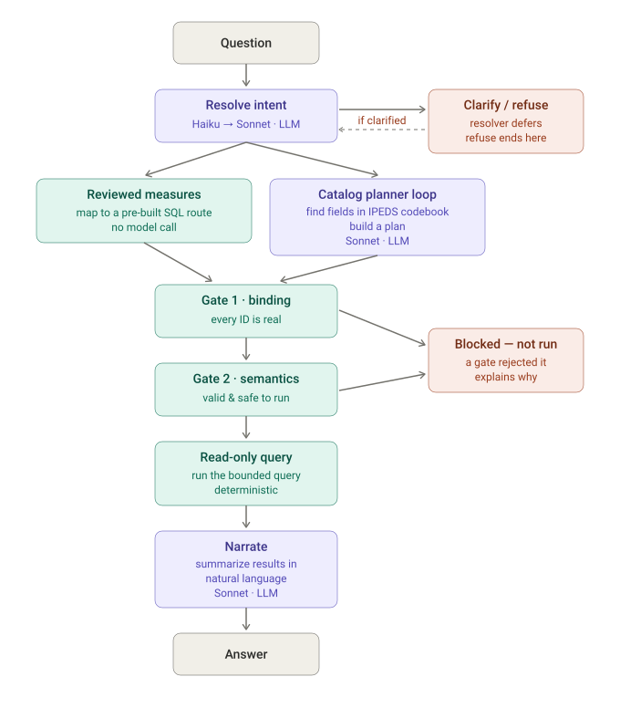

# Tech Stack & Architecture

A concise overview of how the IPEDS Research Companion is built and how a question
becomes an answer. For the design history and deeper rationale, see
[AGENT_ARCHITECTURE.md](AGENT_ARCHITECTURE.md).

**In one line:** a Streamlit app over read-only SQLite copies of IPEDS, where Claude
*plans* but deterministic Python *executes* — which is what keeps every answer
reproducible and auditable.

---

## Tech stack

| Layer | Technology | Role |
| --- | --- | --- |
| Language | **Python 3.11+** | All application and data code |
| UI | **Streamlit** | The single web app and chat interface |
| Data store | **SQLite** | Read-only, per-release IPEDS databases plus a metadata catalog (~3.1 GB); no external database server |
| LLM | **Anthropic Claude API** | **Haiku 5.5** for intent resolution and most planning; **Sonnet 5.5** for harder plans and the plain-language summary |
| Data delivery | **Hugging Face dataset** | Ships the ~3.1 GB of databases; pulled to the host's disk on first boot |
| Hosting | **Render** | Always-on web service |
| Analytics | **Google Sheets** (via gspread) | Optional, anonymous logging of each question and its outcome |
| Quality | `unittest`, eval harness, eval set, deterministic benchmarks | Regression safety across code, pipeline, and data retrieval |

The LLM is the only external runtime dependency. Everything else — the data and the
query engine — runs locally inside the service.

---

## Architecture

The core idea is a **typed-plan engine**: the language model *interprets* questions but
**never writes or runs SQL**. It proposes a typed, source-bound plan that deterministic
code validates and executes. That separation is what makes answers reproducible and
auditable — the same question yields the same plan, and every figure is traceable to a
specific IPEDS table, variable, and reporting period.

The full flow at a glance — purple steps use an LLM, teal steps are deterministic:

### Request flow

1. **Resolve intent** — a Haiku resolver (`resolver_v2`, the default v2 engine)
   classifies each request: answer it, ask a clarifying question, decline an
   out-of-scope ask, treat it as a follow-up to the previous answer, or just hold a
   conversation.
2. **Plan** — via one of two routes:
   - **Reviewed measures** — a curated set of source-bound measures (admission rate,
     graduation rate, salaries, …) that run deterministically, fast, with *no model
     call*.
   - **Catalog planner** — for everything else, Haiku/Sonnet emits a typed plan (which
     institutions, which release years, which exact IPEDS variables, what calculation)
     against the >500-table catalog.
3. **Validate & execute** — deterministic code checks the plan against the metadata
   catalog and the physical database schema, compiles it to a **bounded, read-only
   SQLite** query, runs it, and validates the results before anything is shown.
4. **Narrate** — once results are validated, a separate Sonnet pass writes the
   plain-language summary shown above the table, grounded in the retrieved numbers. This
   step is UI-only and never on the evaluation path.
5. **Log** (optional) — the question and a derived outcome are written fire-and-forget
   to a Google Sheet for analytics.

### Design properties

- **Claude plans, Python executes** — the model never touches the database directly.
- **Deterministic where it counts** — high-value topics use source-bound routes that
  return the complete, correct columns every time, with no model call.
- **Asks before guessing** — ambiguous institutions and measures are clarified rather
  than guessed.
- **Never fabricates** — suppressed or missing values are reported as "not reported,"
  never zero.
- **Shows its sources** — every answer carries the source table, variable definitions,
  reporting period, and the assumptions it made.
- **Tested end to end** — a unit suite guards the code, an eval set exercises the full
  pipeline against ground truth recomputed from live data, and deterministic Yale/NCES
  benchmarks verify data retrieval independently of the AI layer.
